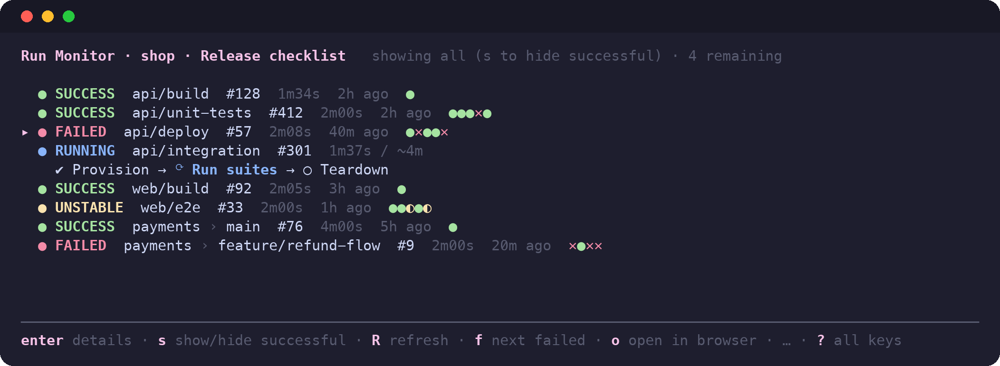
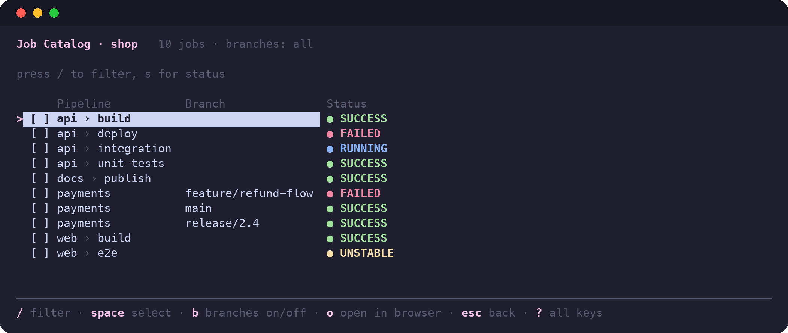
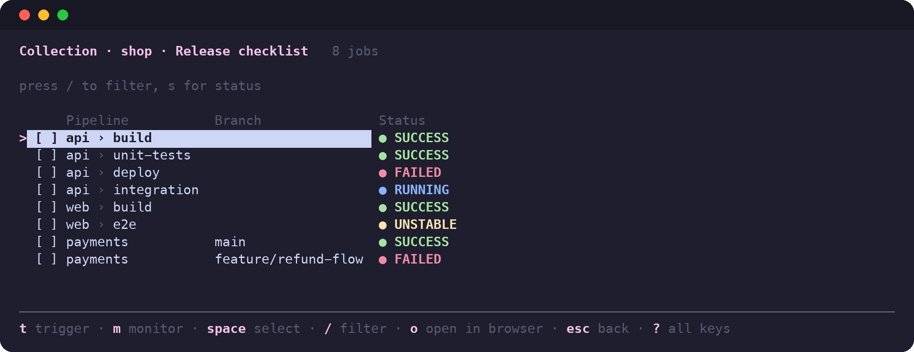
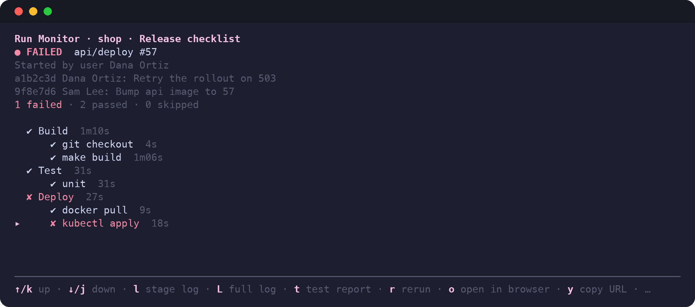
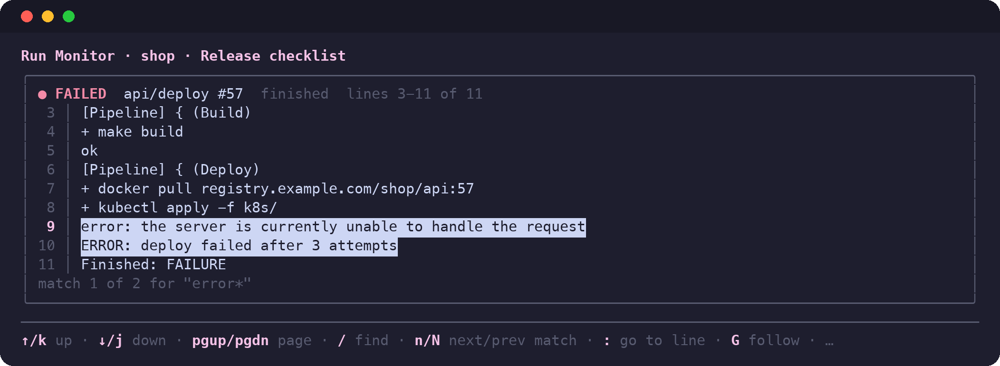

<h1 align="center">jenktui</h1>

<p align="center">
  A terminal UI for Jenkins: curate <b>Collections</b> of jobs, trigger builds in one keystroke,<br>
  and watch the latest build of each job live, down to the stage and step log.
</p>

<p align="center">
  <a href="https://github.com/dursunkoc/jenktui/actions/workflows/ci.yml"></a>
  <a href="https://github.com/dursunkoc/jenktui/releases/latest"></a>
  <a href="https://github.com/dursunkoc/jenktui/releases"></a>
  <a href="go.mod"></a>
  
  <a href="LICENSE"></a>
</p>

<p align="center">
  
</p>

## Features

- **Job Catalog**: every buildable job under a parent folder, flattened, with Multibranch Projects shown one row per branch. Filter by text (with wildcards) and by status.
- **Collections**: named, ordered groups of jobs you pick from the catalog and keep between sessions.
- **Trigger**: a single job gets a confirmation or a parameter form; several jobs share their Common Parameters, with per-job overrides (also from the summary, with `e`) and a summary to confirm.
- **Run Monitor**: the latest build of every job in a Collection, refreshed live (3 s while something runs, 30 s otherwise), with pipeline stages for running builds. Successful jobs are hidden by default so only what needs attention is left.
- **Build details and console log**: move through a build's stages and steps, and read the log of the highlighted stage or step, or of the whole build, in a modal with line numbers, wildcard search and go to line. It follows new output while the build runs.
- **Branch Filter**: one global list of globs that limits which Multibranch branches are shown.
- **Safe by default**: credentials are never stored, and TLS is verified strictly.

## Screenshots

The data in these screenshots is invented (a fake "shop" Jenkins); nothing comes from a real server.

| | |
|---|---|
| **Job Catalog**: every job under the parent folder, with a branch column for Multibranch Projects.<br><br> | **Collection**: a named, ordered group of jobs, ready to trigger or watch.<br><br> |
| **Build details**: stages and steps. `↑`/`↓` move the marker and `l` opens the log of the highlighted stage or step.<br><br> | **Console log**: line numbers, find with wildcards, go to line, follow while the build runs.<br><br> |

## Install

None of these need Go, except the last.

**Homebrew (macOS and Linux)**

```sh
brew install dursunkoc/tap/jenktui
```

**Install script (macOS and Linux)**

```sh
curl -fsSL https://raw.githubusercontent.com/dursunkoc/jenktui/main/install.sh | sh
```

It picks the right build for your system, checks it against the release checksums, and installs `jenktui` to `/usr/local/bin` (or `~/.local/bin` if that is not writable). Set `INSTALL_DIR` to choose another folder and `JENKTUI_VERSION` for a specific version. Read the [script](install.sh) first if you prefer.

**Windows (PowerShell)**

```powershell
[Net.ServicePointManager]::SecurityProtocol = [Net.ServicePointManager]::SecurityProtocol -bor [Net.SecurityProtocolType]::Tls12   # needed on Windows PowerShell 5.1
$v = $env:JENKTUI_VERSION   # optional: set it first (e.g. $env:JENKTUI_VERSION = "0.1.4") to pin a version
if (-not $v) { $v = (Invoke-RestMethod "https://api.github.com/repos/dursunkoc/jenktui/releases/latest").tag_name }
$v = $v.TrimStart("v")
$arch = if ($env:PROCESSOR_ARCHITECTURE -eq "ARM64") { "arm64" } else { "amd64" }
$zip = "jenktui_${v}_windows_$arch.zip"
Invoke-WebRequest "https://github.com/dursunkoc/jenktui/releases/download/v$v/$zip" -OutFile $zip
$dir = "$env:LOCALAPPDATA\Programs\jenktui"
Expand-Archive $zip -DestinationPath $dir -Force
[Environment]::SetEnvironmentVariable("Path", [Environment]::GetEnvironmentVariable("Path", "User") + ";$dir", "User")
```

This installs the latest release; to pin a version, set `$env:JENKTUI_VERSION = "0.1.4"` before running it. If the lookup fails (offline, or GitHub's API rate limit), set `$env:JENKTUI_VERSION` and run it again. Open a new terminal and run `jenktui --version`. Use Windows Terminal; the config is in `%USERPROFILE%\.config\jenktui\`. The [wiki](https://github.com/dursunkoc/jenktui/wiki/Getting-Started) has the checksum check and upgrade steps.

**Download by hand (macOS, Linux)**

Get the archive for your system from the [Releases](https://github.com/dursunkoc/jenktui/releases) page, unpack it, and put `jenktui` on your `PATH` (Windows: use the steps above). On macOS, a file downloaded in a browser is quarantined; clear it once with `xattr -d com.apple.quarantine jenktui`.

**With Go**

```sh
go install github.com/dursunkoc/jenktui@latest
```

or build from a checkout with `go build -o jenktui .`. `jenktui --version` prints the version.

## Quick start

1. Run `jenktui`. On first run, if there is no config file, it asks for your Jenkins URL and an optional parent job and writes `config.toml` for you.
2. Log in with your Jenkins username and a password or an API token (an API token is recommended). Credentials are asked on every start and kept in memory only.
3. Choose **Collections**, press `n`, name the Collection, then tick its jobs in the picker with `Space` (`/` filters) and press `Enter` to save.
4. Open the Collection with `Enter`. Press `t` to trigger and `m` to open its Run Monitor.

The [wiki](https://github.com/dursunkoc/jenktui/wiki) walks through each step in more detail.

## Configuration

`~/.config/jenktui/config.toml` (set `JENKTUI_CONFIG_DIR` to use another directory):

```toml
jenkins_url = "https://jenkins.example.com"
parent_job = ""            # optional; empty = Jenkins root
username = "me"            # optional; prefills the login screen
# ca_cert = "/path/to/ca.pem"
insecure_skip_verify = false
branch_filter = ["main", "release/*"]   # optional; globs for Multibranch branch names
```

Collections are stored in `~/.config/jenktui/collections.toml` and managed by the app.

**Security.** Credentials are never stored: your username and password or API token are asked on every start and live in memory only, as a note at the bottom of the login screen says. TLS is verified strictly. For an internal CA, set `ca_cert`; `insecure_skip_verify` is a last resort.

## Usage

Flow: Splash → Login → Menu (Collections, Job Catalog, Quit).

- **Job Catalog**: every buildable job under the parent job, flattened and filterable.
- **Collections**: named, ordered groups of jobs you pick from the catalog. Open one to trigger its jobs or watch them. A member that no longer exists in Jenkins stays in the Collection, marked missing, and is skipped when triggering.
- **Trigger**: one job gets a confirmation or a parameter form. Several jobs get Common Parameters first (same name and type, entered once), then one step for each job that has parameters of its own (with the Common Parameters it can override), then a summary to confirm. On the summary, `↑`/`↓` pick a job and `e` edits it, so any job, including one with only Common Parameters, can override a Common Parameter. Passwords are shown as `••••`.
- **Run Monitor**: one per Collection, opened with `m`. It shows the latest build of every job, hides successful ones by default, and shows pipeline stages for running builds. A running row shows its progress (`1m36s / ~4m` from Jenkins' estimate, `4m12s (over)` once it overruns) and a finished row shows when it started (`2m ago`, `3h ago`, `yesterday`). Leaving it keeps its state for the session.
  - `Enter` opens a build's details; `↑`/`↓` move between its stages and steps.
  - `l` shows the log of the highlighted stage or step (a stage is its steps' output together); `L` shows the whole build.
  - The log is a modal with line numbers that follows new output while the build runs. `↑`/`↓`/`PgUp`/`PgDn` scroll, `g` goes to the top, `G` follows again, `:` goes to a line number, and `/` finds text (case-insensitive; `*` any text, `_` one character, `\*` `\_` literal), with `n`/`N` for the next and previous match. Matches are highlighted. `Esc` goes back.

Job names are shown relative to the parent job: under `parent_job = "team"`, `team/app/build` is shown as `app/build` (in the catalog, Collections and the Run Monitor). A job outside the parent keeps its full name. If `parent_job` is itself a Multibranch Project (say `team/digital-ui`), its branches are shown as `digital-ui › feature/login` and the Branch Filter applies to them. Job lists have three aligned columns, titled Pipeline, Branch and Status: the job (for a Multibranch Project, the project) with its folders separated by a grey `›` (`team › api › build`), the branch, decoded (`feature/login` rather than `feature%2Flogin`), and the status. The Run Monitor and the trigger screen show a branch as `digital-ui › feature/login`.

### Filtering

Press `/` in any list and type. Matching is case-insensitive, anywhere in the job's full path (including the parent job's part, even though it is not shown):

| Type | Matches |
|---|---|
| `*` | any run of characters (including none) |
| `_` | exactly one character |
| `\*` `\_` `\\` | a literal `*`, `_` or `\` |

Press `↓` to move from the filter box into the list (the filter stays applied) and `↑` on the first row to edit the filter again. `s` cycles a status filter (failed, unstable, running, queued, success, aborted, unknown, missing, off) and combines with the text filter.

### Branch Filter

Limits which branches of Multibranch Projects are shown when browsing or picking. Patterns are case-sensitive globs matched against the decoded branch name (`feature/x`, not `feature%2Fx`); `*` matches any text including `/`, `?` one character, `[a-z]` a set. No patterns means all branches. Folders and ordinary jobs are never filtered, and branches already in a Collection stay there. `b` switches the filter on and off, `B` edits the patterns (saved to `config.toml`).

### Keys

| Where | Keys |
|---|---|
| Everywhere | `↑`/`↓` (or `k`/`j`), `Enter`, `Esc` back, `q` quit, `Ctrl+C` quit |
| Help | The bar at the bottom shows the main keys of the screen. Where it ends in `? all keys`, `?` opens a panel with every key, grouped; `Esc` or `?` closes it |
| Lists | `/` filter, `s` status filter, `Space` select, `a` select all visible, `n` clear selection |
| Filter box | type to filter, `Enter`/`↓` go to the list, `Esc` clear the filter |
| Catalog and picker | `b` Branch Filter on/off, `B` edit patterns, `o` open the highlighted job in the browser (Catalog only) |
| Collections list | `Enter` open, `n` new, `e` edit members, `r` rename, `d` delete, `m` monitor |
| Opened Collection | `t` trigger selected (or the highlighted job), `m` monitor, `e` edit members, `x` remove a missing job, `o` open the highlighted job in the browser, `R` refresh, `Shift+↑/↓` reorder |
| Parameter forms | `Tab`/`Shift+Tab` move, `Enter` next/submit, `Esc` back a step |
| Trigger summary (several jobs) | `↑`/`↓` pick a job, `PgUp`/`PgDn` scroll, `e` edit it (`Enter` on the last field applies, `Esc` cancels), `y`/`Enter` trigger, `n`/`Esc` back |
| Run Monitor | `Enter` details (on a failed build the marker starts on the failed stage; `↑`/`↓` move between stages, `l` stage log (a failed build's log opens at its end), `L` full log, `t` test report (failed tests; `Enter` shows a test's stack trace), with `/` find and `:` go to line), `s` show/hide successful, `R` refresh now, `f` jump to the next failed job, `X` abort the running build (or cancel the queued one) after a `y`/`n` question, `o` open the build in the browser (the job if it has no build yet), `y` copy its URL (list and details), `Esc` back (from details: back to the list) |

## Scope

**In:** job catalog, Collections (create, edit, rename, delete, reorder), triggering with parameters (common and per-job), a per-Collection Run Monitor with stages, logs and abort, Branch Filter.

**Out for now:** rerun (planned), multiple servers, credential storage. See [TODO.md](TODO.md) for remaining work and known gaps.

## Documentation

- [Wiki](https://github.com/dursunkoc/jenktui/wiki): getting started, configuration, filtering, keyboard reference, troubleshooting.
- [GLOSSARY.md](GLOSSARY.md): the terms used in the app and the docs.
- [docs/ui-contract.md](docs/ui-contract.md): UI conventions for contributors.
- [docs/HANDOFF.md](docs/HANDOFF.md): architecture, settled decisions and Jenkins gotchas.

## Development

```sh
go vet ./... && go test ./...
```

CI runs the same plus `gofmt` and `-race` (`.github/workflows/ci.yml`). Tests run against a fake Jenkins in `internal/jenkins/jenkinstest`; it honours the `tree=` query as real Jenkins does (unnamed fields are omitted, `{M,N}` ranges work, the Pipeline REST API ignores it), so a query that names too few fields fails in tests. Still check new queries and endpoints against a real server. Read [docs/HANDOFF.md](docs/HANDOFF.md) first if you are new to the code. The screenshots above are generated from invented data; see HANDOFF for how to regenerate them.

## License

[MIT](LICENSE)
